# NT547 - LAB 06 - BÁO CÁO (TỰ ĐIỀN)

**MSSV:** 24521263  | **Họ tên:** Nguyễn Thị Tuyết Nhi | **Lớp:** NT547.R11.ANTT
**Session code tự sinh:** SC-B029F4 | **Tên contract:** StakingPool_1263
**Solidity / Slither:** 0.8.24 / 0.11.6 | **Ngày hoàn thành:** 19/11/2026
**URL GitHub repository:** https://github.com/ssaw2705/NT547-Lab06-24521263

Môi trường: Windows 11, Python 3.11.9 (venv), solc-select → solc 0.8.24, Slither 0.11.6, Graphviz 16.1.1 (`dot`), git 2.53.

## 1. Static scan (2,0 điểm)

- Lệnh raw: `python tools/scan.py --mode raw --tag before`
- Số lượng finding raw từ `evidence/before_raw/summary.json` (tổng 11):
  - High: 4; Medium: 2; Low: 0; Informational: 4; Optimization: 1
- Chạy configured: `python tools/scan.py --mode configured --tag before` → tổng 7: High 4, Medium 2, Low 0, Informational 0, Optimization 1.
- So sánh raw/configured: config chỉ ẩn 4 Informational (3 × `low-level-calls`, 1 × `naming-convention`) do `exclude_informational: true`; toàn bộ 4 High + 2 Medium **vẫn giữ nguyên** → đổi config không làm mất lỗi nghiêm trọng. Detector `solc-version` bị loại có chủ đích (pragma đã ghim cứng `0.8.24`).
- Ảnh môi trường và lệnh scan:

  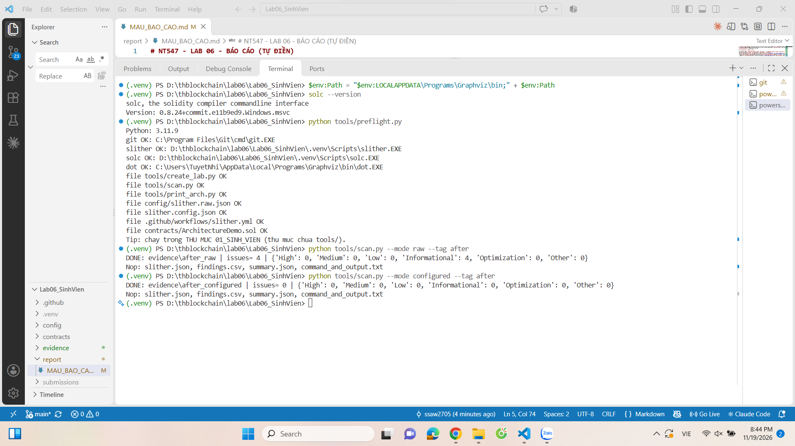
- 3 detector **khác tên**: `reentrancy-eth` (High/Medium), `suicidal` (High/High), `uninitialized-state` (High/High); ngoài ra còn `tx-origin` (Medium/Medium), `incorrect-equality` (Medium/High), `constable-states` (Optimization/High).

Số dòng theo bản baseline (commit `3285ea8`):

| ID finding | Detector | Impact | Confidence | Source (file:dòng) | Luồng dữ liệu: đầu vào -> thao tác -> tác hại |
|---|---|---|---|---|---|
| F01 | reentrancy-eth | High | Medium | AuditTarget.sol:`withdraw()` 51-57 (call dòng 54, ghi state dòng 56) | Người gửi có `ledger > 0` dùng hợp đồng có `receive()` → `call{value: amount}` chuyển ETH **trước** khi `ledger[msg.sender] = 0` → trong `receive()` gọi lại `withdraw()` với số dư cũ → rút lặp, rút cạn ETH của người khác trong pool. |
| F02 | suicidal | High | High | AuditTarget.sol:`shutdown()` 63-65 | Bất kỳ ai gọi `shutdown()` (không có modifier) → `selfdestruct(payable(msg.sender))` → toàn bộ ETH của hợp đồng chuyển cho kẻ gọi (theo EIP-6780 trên mạng sau Cancun, code/storage không bị xoá nhưng **số dư bị lấy sạch**; ledger vẫn ghi nợ nhưng không còn ETH để trả). |
| F03 | uninitialized-state | High | High | AuditTarget.sol:`feeWallet` dòng 13; dùng trong `settleFees()` 59-61 | `feeWallet` không bao giờ được gán → mặc định `address(0)` → owner gọi `settleFees()` → `transfer(balance/2)` tới `0x0` → một nửa số ETH (bao gồm tiền gửi của người dùng) bị đốt vĩnh viễn. |
| F04 | tx-origin | Medium | Medium | AuditTarget.sol:`changeOwner()` 45-49 (dòng 46) | Owner bị dụ gọi một hợp đồng độc hại (vd. nhận airdrop) → hợp đồng đó gọi `changeOwner(attacker)`; `tx.origin` vẫn là owner nên `require` qua → quyền owner bị chiếm → kẻ tấn công dùng `ownerWithdraw` rút toàn bộ ETH. |
| F05 | reentrancy-eth | High | Medium | AuditTarget.sol:`withdrawSafe()` 71-76 (call 73, ghi state 75) | Cùng mẫu "call trước, ghi state sau", nhưng hàm có modifier `exclusive` (mutex) → lần gọi lại `withdrawSafe()`/`fundSafe()` bị chặn bởi `require(!mutex)` → xem triage. |
| F06 | incorrect-equality | Medium | High | AuditTarget.sol:`isEmpty()` 78-80 (dòng 79) | Ai cũng có thể ép ETH vào hợp đồng (vd. `selfdestruct` từ hợp đồng khác) → `balance == 0` sai → nhưng hàm chỉ là `view` trả bool, không được dùng trong điều kiện nào → xem triage. |

## 2. Triage và sửa lỗi (2,5 điểm)

Đọc toàn bộ AuditTarget.sol: **4 mẫu lỗi thật** = F01, F02, F03, F04; **2 đoạn cần đánh giá ngữ cảnh** = F05, F06. Cả 6 đều được Slither báo, không có mẫu nào phải ghi “Manual review / Not reported”.

| Detector + vị trí | TP / FP / Chưa kết luận | Bằng chứng kiểm soát/khả năng khai thác | Biện pháp (Fix / Accept có lý do) | Sau sửa |
|---|---|---|---|---|
| `reentrancy-eth` – `withdraw()` L51-57 | **TP** | Không có guard; state `ledger` cập nhật sau external call; `topUp()` cùng ghi `ledger` → reentrancy cả trong hàm lẫn chéo hàm. | **Fix**: Checks-Effects-Interactions – đặt `ledger[msg.sender] = 0` trước `call` (L64 → call L65). | Hết finding |
| `suicidal` – `shutdown()` L63-65 | **TP** | Hàm `external` không kiểm soát quyền; ai cũng gọi được và nhận toàn bộ ETH. | **Fix**: xoá hẳn `shutdown()` (không cần cho nghiệp vụ; `selfdestruct` đã deprecated, và sau EIP-6780 cũng không còn tác dụng "đóng" hợp đồng). | Hết finding |
| `uninitialized-state` – `feeWallet` L13 / `settleFees()` | **TP** | Không có hàm nào ghi `feeWallet` → chắc chắn là `address(0)` khi `settleFees` chạy. | **Fix**: constructor nhận `initialFeeWallet` (kiểm tra `!= address(0)`), thêm `setFeeWallet()` có `onlyOwner` + kiểm tra zero + emit event. | Hết finding (kéo theo hết `constable-states`) |
| `tx-origin` – `changeOwner()` L46 | **TP** | Xác thực bằng `tx.origin` → khai thác được qua hợp đồng trung gian (phishing). | **Fix**: bỏ `require(tx.origin == owner)`, dùng modifier `onlyOwner` (`msg.sender == owner`); thêm event `OwnerChanged`. | Hết finding |
| `reentrancy-eth` – `withdrawSafe()` L71-76 | **FP** (theo ngữ cảnh) | Modifier `exclusive` đặt `mutex = true` trước thân hàm; mọi hàm ghi `safeBalances` (`fundSafe`, `withdrawSafe`) đều có `exclusive` → gọi lại sẽ revert "reentrant". `withdraw()`/`topUp()` chỉ ghi `ledger`, không chạm `safeBalances`. Slither không mô hình hoá mutex tự viết nên báo High. | **Fix phòng thủ** (ưu tiên sửa mã thay cho suppression): vẫn chuyển sang CEI – `safeBalances[msg.sender] = 0` trước `call`, thêm `require(a > 0)`. | Hết finding |
| `incorrect-equality` – `isEmpty()` L79 | **Accept** (risk thấp) | Hàm `view`, chỉ trả dữ liệu cho UI; không hàm nào trong hợp đồng dùng kết quả làm điều kiện cấp quyền hay chuyển tiền. Ép ETH vào chỉ làm kết quả hiển thị là `false`, không gây mất tiền hay khoá chức năng. | **Accept**: `// slither-disable-next-line incorrect-equality` đặt ngay trên dòng `return` (L87) + comment giải thích. | Đã suppress đúng 1 dòng |

- **Kịch bản khai thác TP (F01 – reentrancy `withdraw`)**: Attacker deploy hợp đồng `A` có `receive()` gọi lại `pool.withdraw()` → `A` gọi `topUp{value: 1 ether}` → `A` gọi `withdraw()`: điều kiện `ledger[A] = 1 ether > 0` qua → `call{value: 1 ether}` kích hoạt `A.receive()` → gọi lại `withdraw()`, lúc này `ledger[A]` **vẫn là 1 ether** vì chưa bị đặt về 0 → lặp tới khi pool cạn → hậu quả: attacker rút toàn bộ ETH của các người gửi khác, chỉ mất 1 ether vốn.
- **Finding severity cao nhưng risk thực tế không tương ứng**: F05 `reentrancy-eth` ở `withdrawSafe()` được Slither xếp **High**, nhưng mutex `exclusive` bao trùm mọi đường ghi `safeBalances` nên không thể re-enter để rút lặp → risk thực tế gần bằng 0 (FP). Tương tự, F06 `incorrect-equality` mức Medium nhưng chỉ ảnh hưởng một giá trị `view` hiển thị.
- **Bằng chứng `git diff`, scan before/after và cảnh báo còn lại**:
  - `git diff 3285ea8 fa493da -- AuditTarget.sol`: 18 dòng thêm, 9 dòng xoá (CEI ở `withdraw`/`withdrawSafe`, xoá `shutdown`, constructor khởi tạo `feeWallet` + `setFeeWallet`, `changeOwner` dùng `onlyOwner`, 2 event, suppression 1 dòng).

    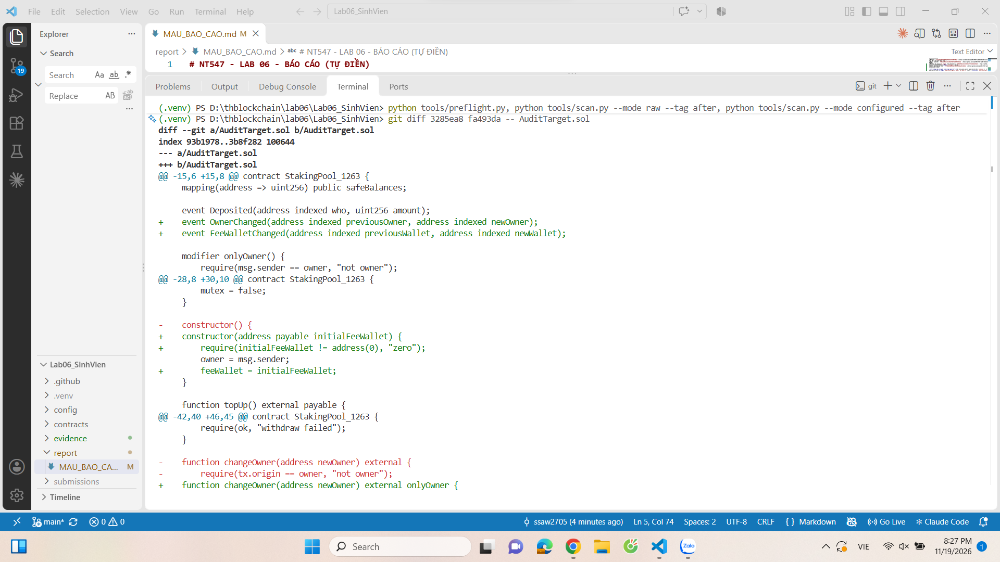
  - Raw: **11 → 4** (High 4→0, Medium 2→0, Optimization 1→0, Informational 4→4). Configured: **7 → 0**.
  - 4 Informational còn lại (raw, `evidence/after_raw/findings.csv`): 3 × `low-level-calls` ở `withdraw`, `withdrawSafe`, `ownerWithdraw` – dùng `call{value:}` là chủ đích (tránh giới hạn 2300 gas của `transfer`), giá trị trả về `ok` đều được `require`, và state đã cập nhật trước call → chấp nhận. 1 × `naming-convention` cho tên contract `StakingPool_1263` – tên do generator sinh theo MSSV, giữ nguyên để khớp `lab_identity.json` → chấp nhận.
- **Lý do của mọi `slither-disable-next-line`**: chỉ có **1** suppression: `incorrect-equality`, đặt đúng trên dòng `return address(this).balance == 0;` trong `isEmpty()` (L87). Kiểm soát bù trừ: hàm là `view`, không được hàm nào khác gọi, không tham gia điều kiện phân quyền hay chuyển tiền; comment ngay trên hàm ghi rõ mục đích chỉ để hiển thị. Không dùng `exclude_medium`/`exclude_high`, không sửa workflow.

## 3. Kiến trúc / Inheritance (1,5 điểm)

- Lệnh printer đã chạy: `python tools/print_arch.py`, tương ứng `slither contracts/ArchitectureDemo.sol --print human-summary --config-file config/slither.raw.json --fail-none` và `slither contracts/ArchitectureDemo.sol --print inheritance-graph --config-file config/slither.raw.json --fail-none`.
  - Ghi chú: Slither 0.11.6 sinh file tên `ArchitectureDemo.sol.inheritance-graph.dot`, còn script tìm `ArchitectureDemo.sol.dot` nên báo “Khong tim thay *.dot”. Em không sửa script, mà thực hiện thủ công bước còn lại: copy `.dot` vào `evidence/architecture/` và render bằng `dot -Tpng evidence/architecture/ArchitectureDemo.sol.inheritance-graph.dot -o evidence/architecture/inheritance.png`.
- Ảnh `evidence/architecture/inheritance.png` (DOT: `evidence/architecture/ArchitectureDemo.sol.inheritance-graph.dot`): `StudentAsset` kế thừa `AccessManaged` (cạnh 1) và `BalanceLedger` (cạnh 2). Human summary: 3 contract, 23 SLOC, 0 High/Medium/Low, 1 optimization; `StudentAsset` có 4 hàm.
- Ảnh đánh dấu node: `evidence/screenshots/10_inheritance_annotated.png`, render từ `evidence/architecture/inheritance_annotated.dot`. File này giữ nguyên node và cạnh của DOT gốc do Slither sinh, chỉ tô màu và gắn nhãn vai trò: [1] đỏ là quyền (`AccessManaged`), [2] xanh dương là số dư (`BalanceLedger`), [3] xanh lá là entrypoint (`StudentAsset`).

  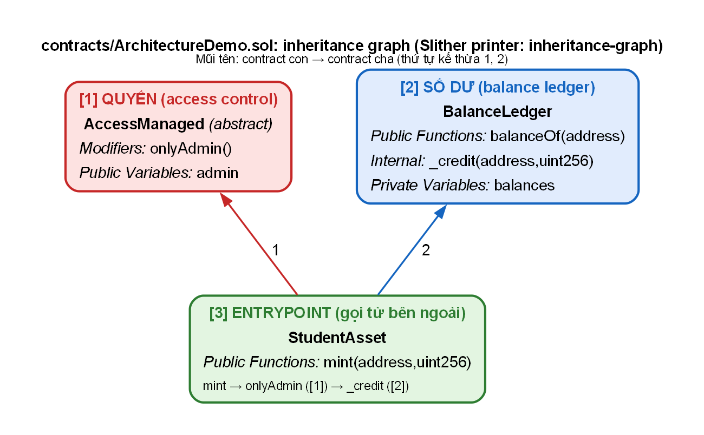
- Access control nằm ở **`AccessManaged`** (biến `admin`, modifier `onlyAdmin`); logic số dư nằm ở **`BalanceLedger`** (mapping `balances`, `balanceOf`, `_credit` internal); contract triển khai nằm ở **`StudentAsset`** (entrypoint `mint(address,uint256)`).
- Giải thích 3–5 câu điểm audit cần bắt đầu: Logic security-critical không nằm ở contract triển khai mà ở hai contract cha: `AccessManaged` quyết định ai được phép (`admin` gán trong constructor, không có hàm đổi admin), còn `BalanceLedger._credit` là nơi duy nhất thay đổi số dư. Entrypoint thay đổi state duy nhất từ bên ngoài là `StudentAsset.mint`, được bảo vệ bởi `onlyAdmin` rồi gọi `_credit`. Vì vậy audit nên bắt đầu từ `mint` (bề mặt tấn công), lần theo modifier `onlyAdmin` để xác minh danh tính dùng `msg.sender` và `admin` được khởi tạo đúng, rồi đến `_credit` để kiểm tra phép cộng số dư. Nếu modifier ở contract cha sai (vd. đổi sang `tx.origin`), mọi hàm con dùng nó đều bị ảnh hưởng, nên các contract cha có mức ưu tiên audit cao nhất.

## 4. Red -> Green CI (2,5 điểm)

| Phase | Commit (full/short SHA) | Run URL | Kết quả | Detector khiến RED / lý do GREEN |
|---|---|---|---|---|
| Baseline vulnerable | `3285ea89aa23d0078f3439d301456fe442ce5328` (`3285ea8`) | https://github.com/ssaw2705/NT547-Lab06-24521263/actions/runs/44523144887 | RED | Step “Slither Solidity 0.8.24 (High + Medium gate)” fail: `reentrancy-eth` ×2, `suicidal`, `uninitialized-state` (High); `incorrect-equality`, `tx-origin` (Medium); log CI: “AuditTarget.sol analyzed (2 contracts with 64 detectors), 7 result(s) found”, đúng 7 finding như `before_configured` ở local (solc 0.8.24 cũng cảnh báo `selfdestruct` deprecated tại dòng 64) |
| Patched | `fa493da9feeba0ccf12eb7fd508808645fbb7bfa` (`fa493da`) | https://github.com/ssaw2705/NT547-Lab06-24521263/actions/runs/44523519334 | GREEN | 4 TP đã sửa, F05 sửa CEI, F06 suppress có lý do → 0 finding ở ngưỡng Medium/High |

**Baseline RED** (run 44523144887, commit `3285ea8`):

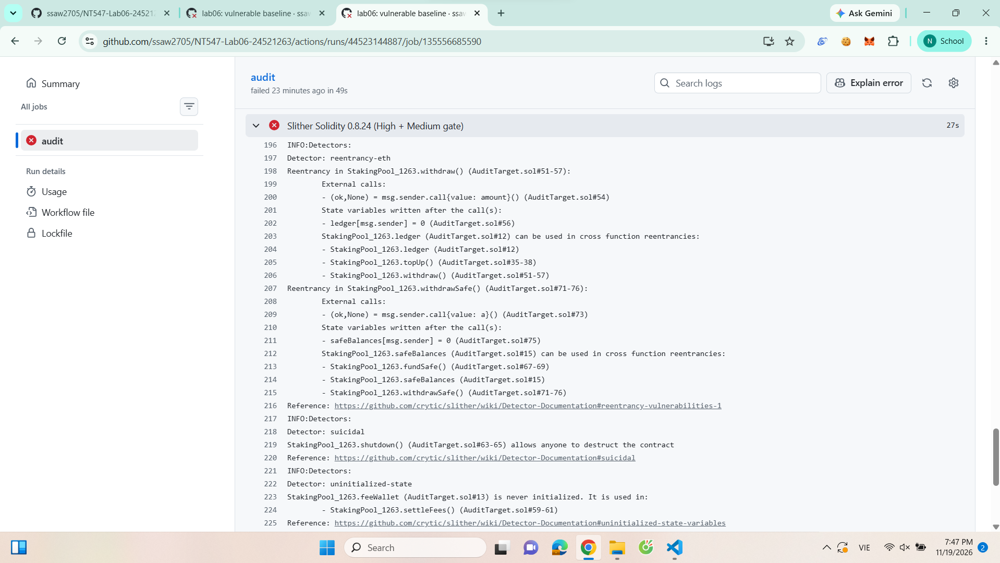
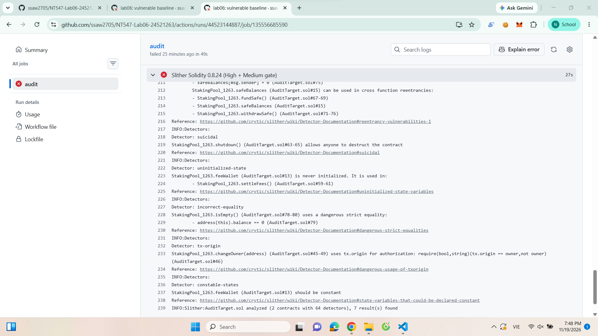
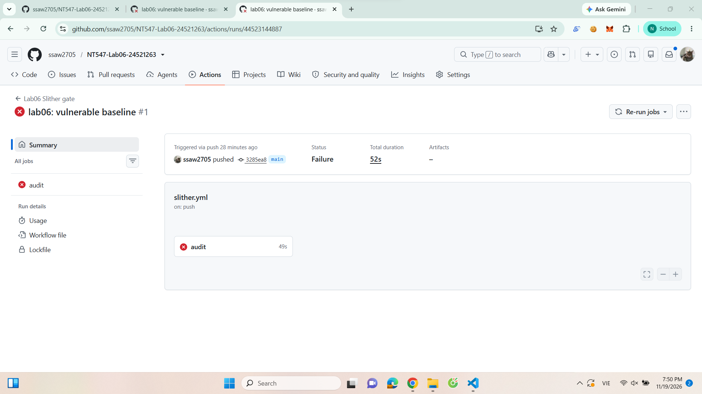

**Patched GREEN** (run 44523519334, commit `fa493da`):

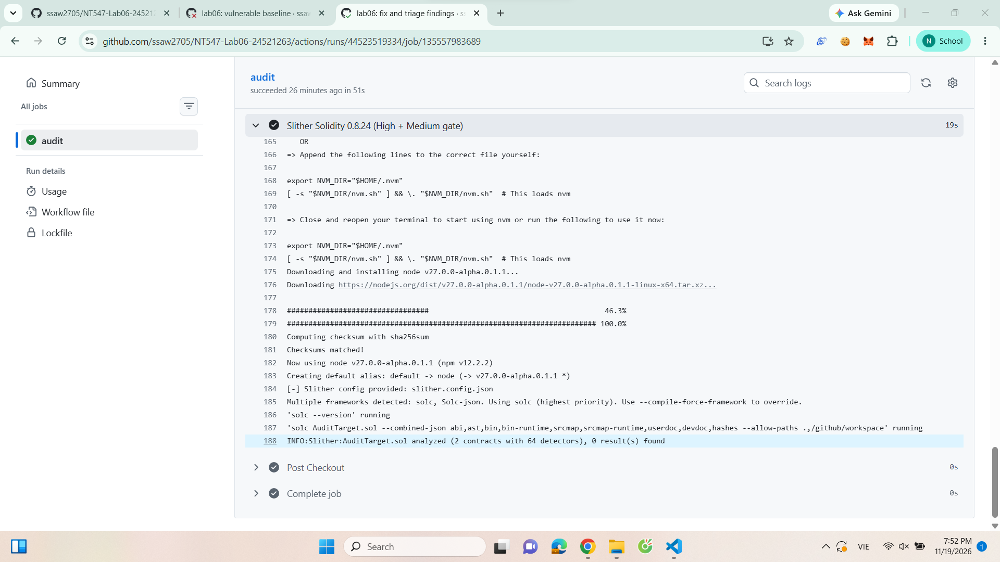
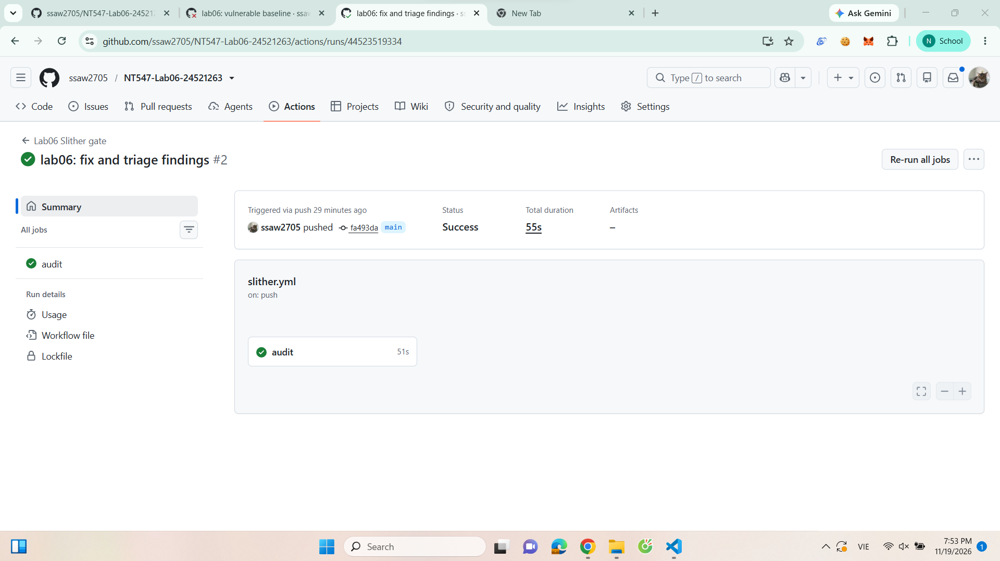

- So sánh local `--fail-none` (thu thập findings) với CI `fail-on: medium`: `scan.py` chạy Slither với `--fail-none` nên exit code luôn là 0 dù có 4 High (xem `process_exit_code: 0` trong `before_raw/summary.json`); mục đích là thu đủ JSON/CSV làm bằng chứng, không phải để đánh giá an toàn. CI dùng `fail-on: medium` nên job fail ngay khi còn ≥1 finding Medium hoặc High. Em đã tái hiện ngưỡng CI ở local bằng `slither AuditTarget.sol --config-file slither.config.json --fail-medium` trên bản đã sửa → 0 result, exit 0, khớp với run GREEN.
- `exclude_low/informational` thay đổi kết quả hiển thị ra sao: chúng chỉ ẩn finding Low và Informational khỏi output (before: 11 → 7, after: 4 → 0); không ảnh hưởng High/Medium nên không thay đổi kết luận của gate. Optimization (`constable-states`) vẫn hiển thị vì config không có `exclude_optimization`, nhưng không làm CI fail.

## 5. Mutation RED -> GREEN (1,5 điểm)

- Mutation một dòng: `require(msg.sender == owner, "not owner")` -> `require(tx.origin == owner, "not owner")` trong `modifier onlyOwner` (dòng 22). `git show bcf12bb --stat`: `1 file changed, 1 insertion(+), 1 deletion(-)`.
- Detector kỳ vọng: `tx-origin` (mức Medium); xác nhận của em từ CI: **CI KHÔNG RED, run mutation GREEN.** Quét local cùng commit (`python tools/scan.py --mode configured --tag mutation`, lưu tại `evidence/mutation_configured/`) cũng cho **0 finding**, khớp với CI.
  - Nguyên nhân (đã kiểm chứng trong mã nguồn Slither 0.11.6, `slither/detectors/statements/tx_origin.py`, hàm `detect_tx_origin`): detector chỉ duyệt `for f in contract.functions`, tức chỉ các function, **không duyệt modifier**. Vì vậy `tx.origin` trong `modifier onlyOwner` không bị báo, trong khi ở baseline `tx.origin` nằm trong thân function `changeOwner()` nên bị báo. Đây là false negative của công cụ: lỗ hổng vẫn tồn tại thật (mọi hàm `onlyOwner` như `ownerWithdraw`, `changeOwner`, `setFeeWallet`, `settleFees` đều bị ảnh hưởng), nhưng gate không bắt được.

| Phase | Commit SHA | Run URL | Kết quả |
|---|---|---|---|
| Mutation | `bcf12bb240a394f0292da9283b8c7b4f09700ea9` | https://github.com/ssaw2705/NT547-Lab06-24521263/actions/runs/44523793783 | GREEN (kỳ vọng RED – xem giải thích trên) |
| Revert mutation | `fd8811e4952ec13bcb62d786dfbe08b925353ecd` | https://github.com/ssaw2705/NT547-Lab06-24521263/actions/runs/44524025584 | GREEN |
| Mutation đối chứng (`tx.origin` trong function) | `03067b94bb1113c327394c11f870116163edf2dd` | https://github.com/ssaw2705/NT547-Lab06-24521263/actions/runs/44528711853 | **RED** (`tx-origin`, Medium) |
| Revert mutation đối chứng | `ff73b0e23a80cc1b57d81c44f6de1a404c8d8114` | https://github.com/ssaw2705/NT547-Lab06-24521263/actions/runs/44528956410 | GREEN |

- **Thí nghiệm đối chứng để kiểm chứng nguyên nhân:** để chứng minh quality gate vẫn bắt được `tx-origin` và lý do GREEN ở trên đúng là do vị trí modifier, em thêm **1 dòng** `require(tx.origin == owner, "not owner");` vào thân **function** `ownerWithdraw()` (commit `03067b9`, `1 file changed, 1 insertion(+)`), giữ nguyên `modifier onlyOwner` dùng `msg.sender`.
  - Local (`python tools/scan.py --mode configured --tag mutation2`, lưu tại `evidence/mutation2_configured/`): 1 finding `tx-origin` Medium – “StakingPool_1263.ownerWithdraw(uint256) (AuditTarget.sol#44-48) uses tx.origin for authorization … (AuditTarget.sol#45)”.
  - CI: run **RED** vì `tx-origin`, đúng ngưỡng `fail-on: medium`. Sau đó em revert bằng `git revert --no-edit HEAD` (commit `ff73b0e`) → CI **GREEN**; `main` cuối cùng ở trạng thái an toàn.
  - Kết luận: cùng một biểu thức `tx.origin == owner`, cùng detector, cùng cấu hình CI: đặt trong function → RED, đặt trong modifier → GREEN. Như vậy quality gate hoạt động đúng, còn khoảng trống nằm ở độ phủ của detector `tx-origin` trong Slither 0.11.6 (không duyệt modifier). Thí nghiệm này là bằng chứng bổ sung, không thay thế mutation bắt buộc ở trên.

**Mutation bắt buộc** (commit `bcf12bb`, đổi đúng 1 dòng trong `modifier onlyOwner`):

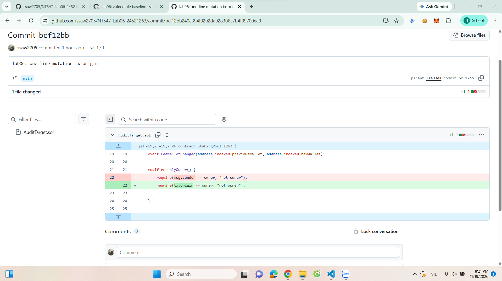
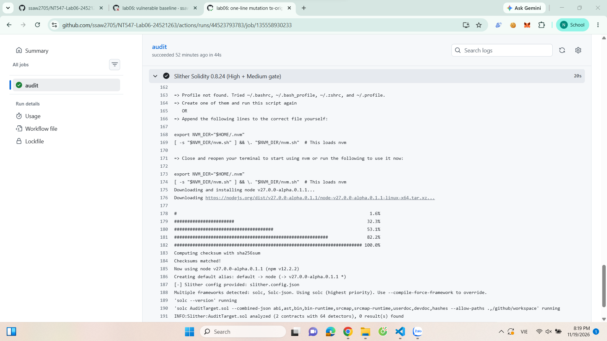
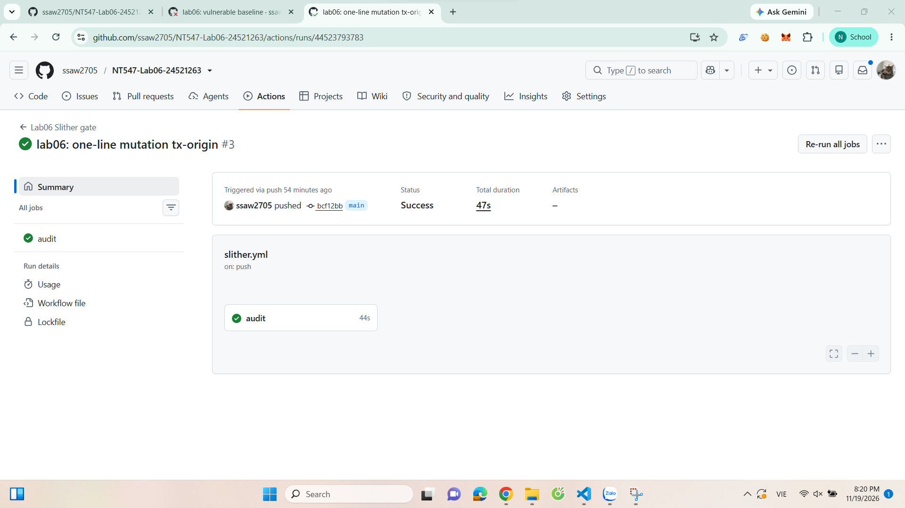

**Revert mutation** (commit `fd8811e`):

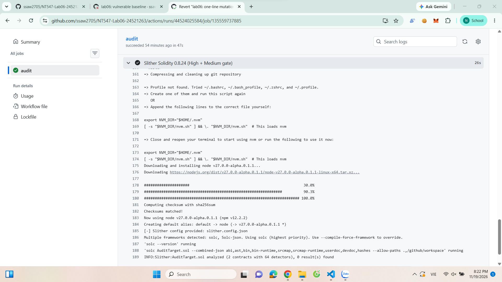
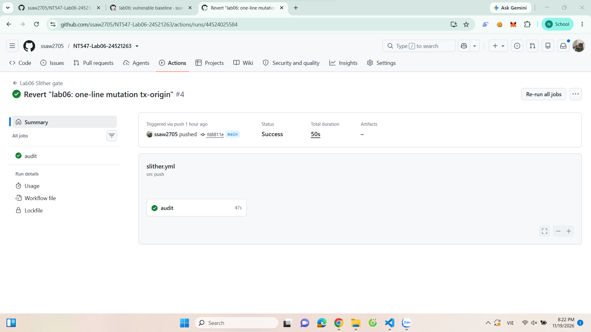

**Mutation đối chứng RED** (commit `03067b9`) và **revert** (commit `ff73b0e`):

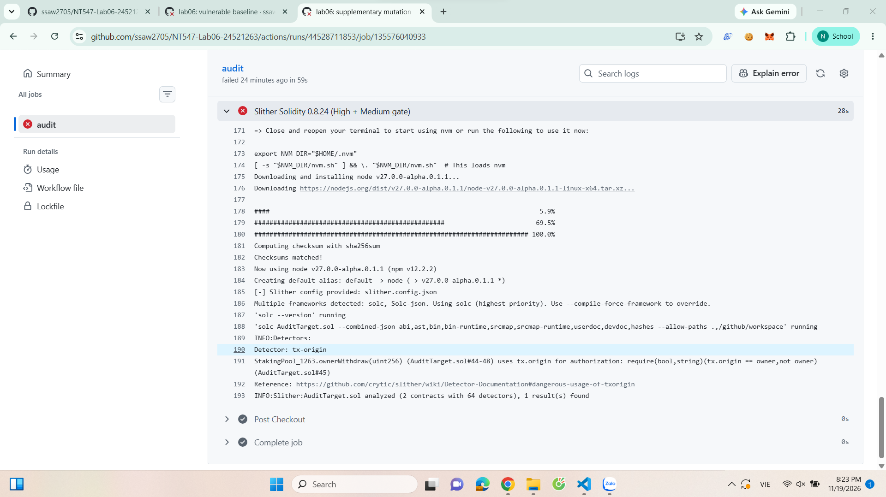
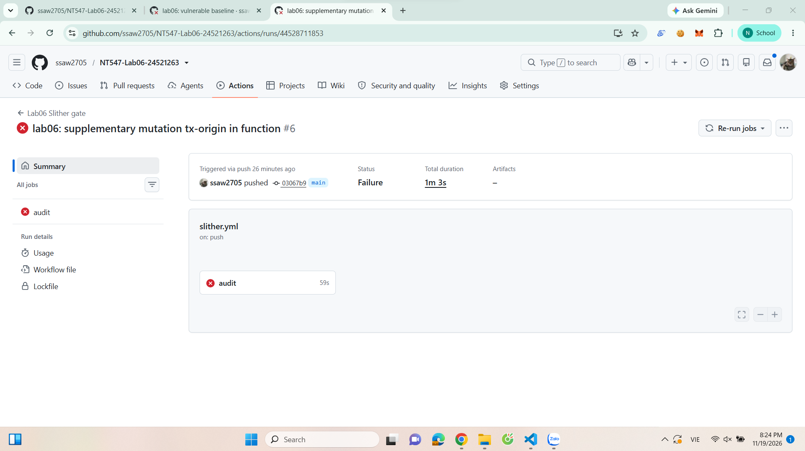
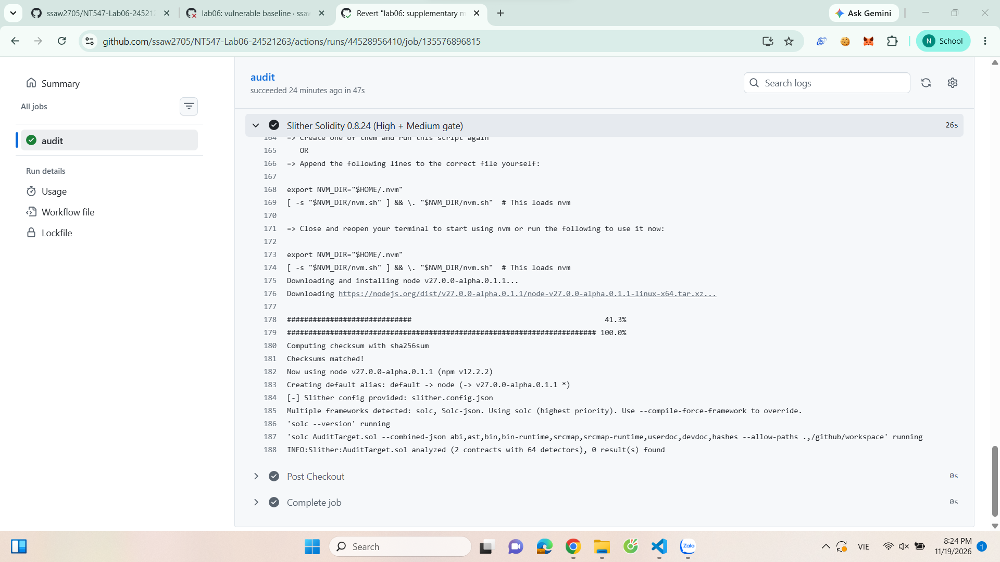
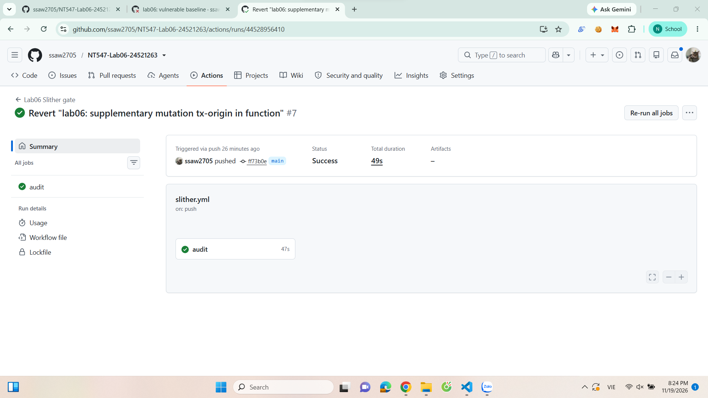

- Giải thích sự thay đổi về nguồn định danh/authorization: `msg.sender` là địa chỉ gọi trực tiếp hàm hiện tại, còn `tx.origin` là EOA đã ký giao dịch gốc. Khi chuyển sang `tx.origin`, bất kỳ hợp đồng trung gian nào mà owner tương tác (bị dụ ký giao dịch) đều có thể gọi các hàm `onlyOwner` thay owner và vượt qua kiểm tra, ví dụ gọi `changeOwner(attacker)` hoặc `ownerWithdraw(balance)`. Mutation vì vậy làm hỏng toàn bộ access control. Việc CI vẫn GREEN cho thấy quality gate chỉ mạnh bằng độ phủ của detector: static analysis cần đi kèm review thủ công và test (vd. test gọi `onlyOwner` qua contract trung gian phải revert).

## 6. Bằng chứng, tự kiểm

- [x] `AuditTarget.sol`, `lab_identity.json`
- [x] `evidence/before_raw/` và `evidence/before_configured/`
- [x] `evidence/after_raw/` và `evidence/after_configured/` (thêm `evidence/mutation_configured/` và `evidence/mutation2_configured/`)
- [x] `evidence/architecture/` (human_summary.txt, .dot, inheritance.png, printer_log.txt)
- [x] 04 URL Actions run + 04 commit SHA (mutation bắt buộc GREEN, đã giải thích ở mục 5) + 02 run mutation đối chứng RED → GREEN
- [x] Link repo và ảnh màn hình có terminal / URL / commit SHA; không cắt mất ngữ cảnh (toàn bộ ảnh trong `evidence/screenshots/`)

**Lịch sử commit** (`git remote -v`, `git log --oneline`, `git status`):

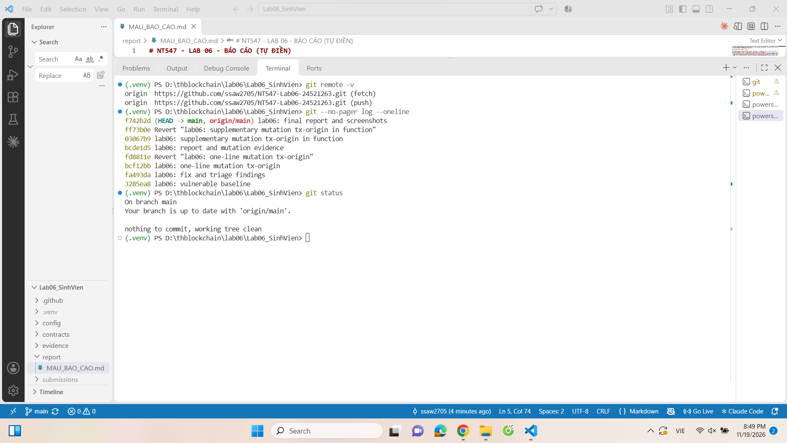
- [x] Các finding được triage, không chép lại mô tả detector thay cho suy luận
- [x] Tuyệt đối không có seed phrase, private key, credentials

**Nhận xét cuối cùng (5–7 câu):** Slither phát hiện nhanh cả 6 mẫu cần xem xét trong StakingPool_1263, nhưng chỉ 4 trong số đó là lỗi thật; 2 cảnh báo còn lại (reentrancy có mutex, so sánh bằng trong hàm view) phải đọc ngữ cảnh mới phân loại đúng. Việc sửa chủ yếu dựa trên Checks-Effects-Interactions, xác thực bằng `msg.sender`, khởi tạo state và loại bỏ hàm nguy hiểm. Em ưu tiên sửa mã thay vì suppression và chỉ dùng 1 suppression có lý do cho hàm view. Quality gate `fail-on: medium` trên GitHub Actions chuyển đúng từ RED sang GREEN sau khi sửa. Tuy nhiên bước mutation cho thấy giới hạn của công cụ: Slither 0.11.6 không kiểm tra `tx.origin` trong modifier nên CI vẫn GREEN dù access control đã bị phá; thí nghiệm đối chứng đặt cùng biểu thức vào một function thì CI RED ngay, xác nhận khoảng trống nằm ở độ phủ detector chứ không ở gate. Bài học là static analysis trong CI là lớp bảo vệ cần thiết nhưng không đủ, phải kết hợp review thủ công và unit test cho các đường phân quyền.
